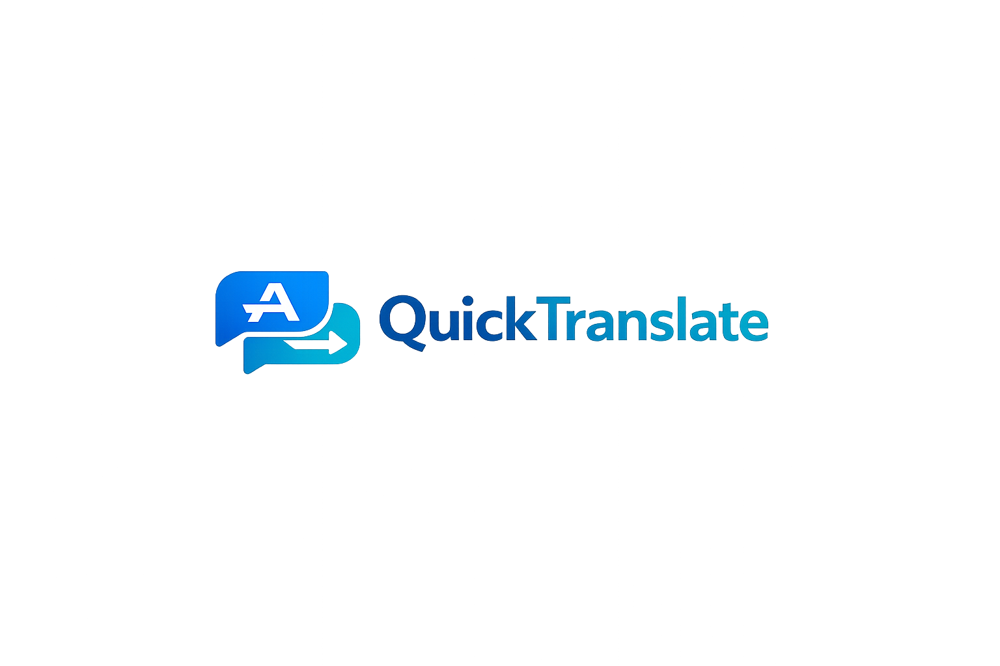

# QuickTranslate — תרגום מהיר מכל מקום במחשב



אפליקציית Desktop קלה לתרגום טקסט — **עברית-first, RTL-first**.
בנויה על **Tauri v2 + React + TypeScript** (לא Electron).

**אתר:** https://4pdara.github.io/QuickTranslate/
**גרסאות:** https://github.com/4pdara/QuickTranslate/releases
**מאגר:** https://github.com/4pdara/QuickTranslate

---

## הורדה

| קובץ | תיאור |
|---|---|
| [QuickTranslate_0.1.2_x64-setup.exe](https://github.com/4pdara/QuickTranslate/releases/download/v0.1.2/QuickTranslate_0.1.2_x64-setup.exe) | Windows Installer (מומלץ) |
| [QuickTranslate_0.1.2_x64_en-US.msi](https://github.com/4pdara/QuickTranslate/releases/download/v0.1.2/QuickTranslate_0.1.2_x64_en-US.msi) | MSI Installer |
| [QuickTranslate_0.1.2_portable.zip](https://github.com/4pdara/QuickTranslate/releases/download/v0.1.2/QuickTranslate_0.1.2_portable.zip) | גרסה ניידת (ללא התקנה) |

> **למשתמשי קצה:** אין צורך ב-Rust, Node, npm, או כל כלי פיתוח. פשוט הורידו והריצו את ה-installer.
> הגרסה הניידת (portable) רצה ישירות ללא התקנה — דורשת WebView2 שמובנה ב-Windows 11 ו-Windows 10 מעודכן.
> לכל הגרסאות הקודמות ופרטי השחרור ראו [GitHub Releases](https://github.com/4pdara/QuickTranslate/releases).

---

## תכונות עיקריות

- **תרגום טקסט מסומן** — סמנו טקסט בכל אפליקציה ולחצו `Ctrl+Shift+T` (ניתן לשינוי דינמי בהגדרות ללא הפעלה מחדש)
- **SelectedTextCaptureEngine** — קריאת טקסט ישירה דרך Windows UI Automation (ללא גישה ללוח)
- **חלונית תרגום צפה** — פופאפ קטן שמופיע מיד, ללא החלפת חלון
- **System Tray והקפצה לחזית** — רצה ברקע, לחיצה על אייקון המגש או קיצור הדרך בשולחן העבודה מקפיצה את החלון מיד לקדמת המסך
- **תפריט מגש:** פתח מתרגם / פתח הגדרות / תרגם טקסט מהלוח / יציאה
- **ממשק עברי RTL** מלא עם שימור טקסט ותרגום גם במעבר להגדרות וחזרה
- **ספקים חינמיים כברירת מחדל:** Google Translate ללא API (מבוסס Endpoint תוסף יציב), LibreTranslate, Lingva
- **ספקים מתקדמים:** Google Cloud Translation, DeepL (דורשים מפתח API)
- **קל-משקל** — Tauri v2 (Rust + WebView2), לא Electron

## ספקי תרגום

| ספק | קטגוריה | דורש מפתח |
|---|---|---|
| Google Translate ללא API | ניסיוני | לא |
| LibreTranslate | חינמי/קוד פתוח | לא (אופציונלי) |
| Lingva Translate | ניסיוני | לא |
| Google Cloud Translation | מתקדם | כן (בתשלום) |
| DeepL | מתקדם | כן |
| Azure Translator | עתידי (stub) | — |

> ⚠️ **Google Translate ללא API** הוא endpoint ציבורי לא-רשמי ועלול להיחסם או להשתנות בכל עת.
> לשימוש יציב, מומלץ להגדיר ספק עם מפתח API.

---

## הרצה לפיתוח (Desktop App)

**דרישות:** [Rust](https://www.rust-lang.org/) + [Visual Studio Build Tools](https://visualstudio.microsoft.com/visual-cpp-build-tools/) (C++ workload) + Node.js 24+

```bash
npm install
npm run tauri dev
```

בהרצת `tauri dev` נפתח חלון קונסולה — תקין ב-dev, לא מופיע בגרסת ההפצה.

## בנייה להפצה

```bash
npm run tauri build
```

מייצר:
- `src-tauri/target/release/bundle/nsis/QuickTranslate_0.1.2_x64-setup.exe`
- `src-tauri/target/release/bundle/msi/QuickTranslate_0.1.2_x64_en-US.msi`
- `src-tauri/target/release/tauri-app.exe` ← גרסה ניידת (rename ל-QuickTranslate.exe)

## אתר הנחיתה

```bash
cd site
npm install
npm run dev      # תצוגה מקומית → http://localhost:5173/QuickTranslate/
npm run build    # בנייה לייצור → site/dist/
npm run preview  # תצוגה מקדימה של ה-build
```

GitHub Pages מופעל אוטומטית ב-push ל-main (`.github/workflows/deploy-pages.yml`).
**כתובת האתר:** https://4pdara.github.io/QuickTranslate/

## web preview מקומי (UI בלבד, בלי Tauri)

```bash
npm run dev
# → http://localhost:1420
```

בדפדפן מוצג באנר "מצב תצוגת אתר". תרגום לא יעבוד (CORS) — ה-UI בלבד.

## בדיקות

```bash
npx tsc --noEmit          # TypeScript
npm test                  # בדיקות רגרסיה
npm run build             # Frontend build
cargo test --locked --manifest-path src-tauri/Cargo.toml  # Rust
```

## פרטיות ואבטחה

- ללא חשבון משתמש, ללא backend בענן, ללא טלמטריה.
- מפתחות API נשמרים מקומית ב-`%APPDATA%/com.quicktranslate.desktop/`.
- הטקסט נשלח רק לספק התרגום שנבחר.
- לכידה ישירה אינה משנה את הלוח. גיבוי Ctrl+C, אם מופעל במפורש, עשוי להחליף
  את תוכנו; כך גם העתקת תוצאה ידנית או אוטומטית לפי ההגדרות. היסטוריית הלוח אינה נמחקת.

## לפרטי ארכיטקטורה

ראו [CLAUDE.md](./CLAUDE.md) ואת תיקיית [docs/](./docs/).
